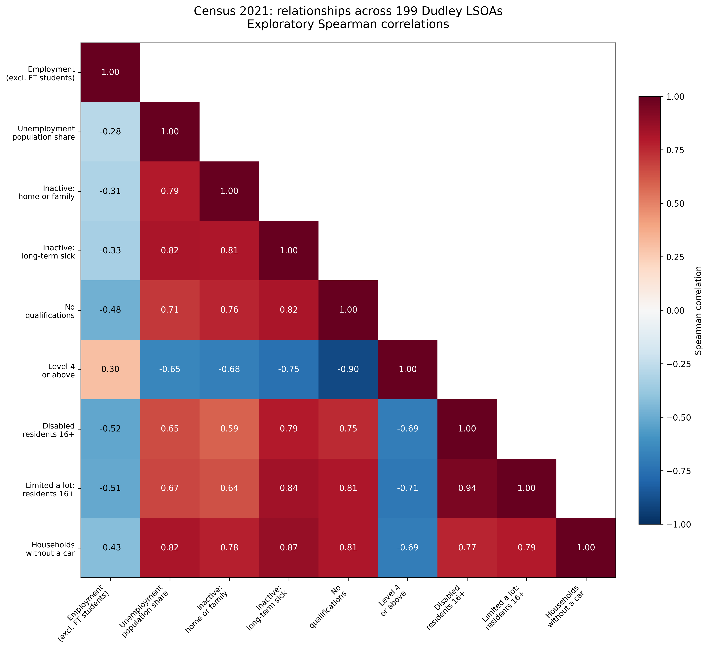
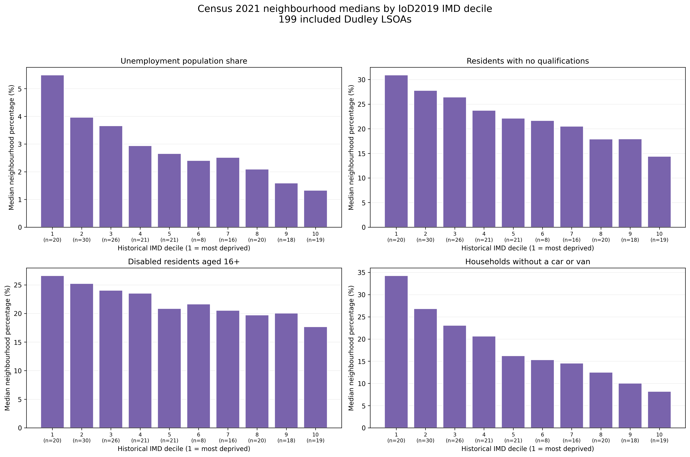
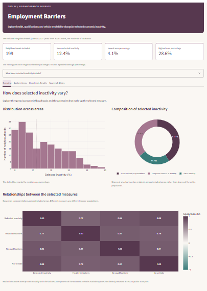
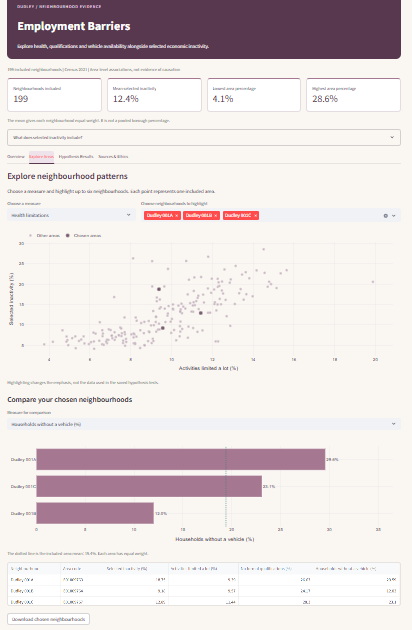
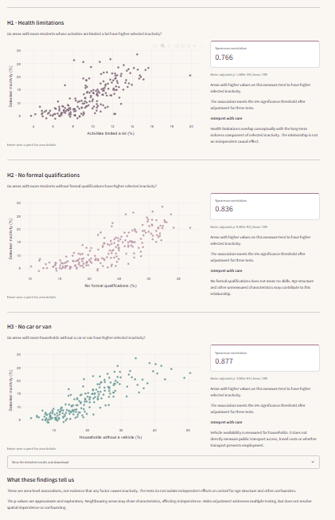

# Dudley Employment Barriers

**Dudley Employment Barriers** explores how health limitations,
qualifications and access to a car or van relate to economic inactivity
in Dudley. The project brings together Census 2021 data and the English
Indices of Deprivation 2019 for 199 neighbourhoods with matching boundaries.

The aim is to understand where potential barriers to employment overlap
and what these patterns could mean for local support needs. The findings
are presented through data analysis, hypothesis testing and an interactive
Streamlit dashboard.

# 

## Dataset Content

The project combines four Census 2021 datasets with the English Indices
of Deprivation 2019 to explore potential employment barriers in Dudley.
Each row represents a Lower-layer Super Output Area (LSOA), a small
geographical area used for reporting neighbourhood statistics.

The Census datasets were obtained from ONS through Nomis. Each cleaned
dataset contains 203 Dudley LSOAs. The deprivation dataset contains
201 Dudley LSOAs based on 2011 boundaries. An ONS geographical lookup
was used to identify 199 areas with unchanged boundaries, allowing
the datasets to be combined without estimating values for changed areas.

| Dataset | Content used in the project | Population covered |
| :--- | :--- | :--- |
| Economic activity — TS066 | Employment, unemployment and reasons for economic inactivity | Residents aged 16 and over |
| Highest level of qualification — TS067 | No qualifications and qualification levels, from entry level to Level 4 and above | Residents aged 16 and over |
| Disability — RM019 | Disability status and whether day-to-day activities are limited a little or a lot | Residents aged 16 and over |
| Car or van availability — TS045 | Households with no car or van, one, two, or three or more vehicles | Households |
| English Indices of Deprivation 2019 | Overall deprivation and domains including employment, education and health | Area-level measures with indicator-specific population coverage |
| ONS LSOA 2011 to 2021 lookup | Area codes and boundary-change information used to check geographical compatibility | LSOAs |

Counts were converted into percentages using the relevant population
or household totals so that areas of different sizes could be compared.
The original counts were retained alongside the calculated measures.

The combined dataset contains 199 neighbourhoods. It includes measures
of disability, qualifications, car availability and economic activity,
with deprivation indicators providing additional context.

These are neighbourhood-level statistics, not individual records.
Census 2021 and deprivation data from 2019 describe different periods,
so the combined dataset provides a historical view of Dudley rather
than a measure of current conditions.

---

## Business Requirements

The project aims to help local employment services, community organisations
and decision-makers explore neighbourhood patterns that may indicate a need
for further investigation or support. It focuses on three potential barriers:
health limitations, qualifications and access to transport.

1. **Explore health-related barriers to participation.**
   Examine how neighbourhood disability rates relate to economic inactivity
   due to long-term sickness or disability, and to unemployment. These
   relationships must not be used to assume an individual's ability to work.

2. **Understand the relationship between qualifications and economic activity.**
   Investigate whether areas with higher proportions of residents with no
   formal qualifications also have higher unemployment or lower economic
   participation. Formal qualifications are one measure and do not capture
   all practical skills, experience or barriers to employment.

3. **Investigate potential transport barriers.**
   Explore how the proportion of households without a car or van relates
   to employment and economic inactivity. Car availability is a limited
   indicator: it does not directly measure public transport provision,
   affordability, accessibility or travel time to suitable jobs.

4. **Communicate findings through an accessible dashboard.**
   Present neighbourhood comparisons and hypothesis-testing results in an
   interactive Streamlit dashboard, with clear explanations of the measures,
   population coverage and limitations. Distinguish unemployment from
   economic inactivity and statistical associations from causal evidence.

5. **Support informed discussion about local needs.**
   Use the findings to highlight questions for further research and
   consultation with residents and service providers. The analysis should
   not be used to rank individuals, label communities negatively or make
   decisions about benefit eligibility or access to support.

These requirements apply to the 199 matched LSOAs included in the analysis.
Findings reflect historical data and should be considered alongside current
local evidence before informing service planning.

---

## Hypothesis and How to Validate

The three hypotheses were tested across 199 matched Dudley LSOAs using Spearman's rank correlation. Each test examined the relationship between one potential barrier and the same measure of selected economic inactivity.

### H1: Health Limitations

**Hypothesis:** Neighbourhoods with a higher percentage of residents aged 16 and over whose day-to-day activities are limited a lot have a higher percentage of selected economic inactivity.

**Validation:** Spearman's correlation was calculated between `Limited_A_Lot_16_Plus_Pct` and `Selected_Inactive_Pct`.

**Result:** A strong positive association was found (ρ = 0.766; Holm-adjusted p ≈ 1.085 × 10⁻³⁹).

**Interpretation and ethical considerations:** Areas with higher levels of substantial activity limitations tended to have higher selected inactivity. However, the outcome itself includes inactivity due to long-term sickness or disability, so the measures overlap conceptually. This result must not be used to conclude that disabled individuals cannot work, are unwilling to work, or should be excluded from employment opportunities.

### H2: Qualifications

**Hypothesis:** Neighbourhoods with a higher percentage of residents aged 16 and over without formal qualifications have a higher percentage of selected economic inactivity.

**Validation:** Spearman's correlation was calculated between `No_Qualifications_Pct` and `Selected_Inactive_Pct`.

**Result:** A strong positive association was found (ρ = 0.836; Holm-adjusted p ≈ 5.483 × 10⁻⁵³).

**Interpretation and ethical considerations:** Areas with more residents without formal qualifications tended to have higher selected inactivity. This does not show that a lack of qualifications caused inactivity or that training alone would resolve it. Formal qualifications do not capture practical skills, work experience or unpaid caring contributions. Differences in age, health and local opportunities may also contribute to the relationship.

### H3: Household Car Availability

**Hypothesis:** Neighbourhoods with a higher percentage of households without a car or van have a higher percentage of selected economic inactivity.

**Validation:** Spearman's correlation was calculated between `No_Car_Van_Households_Pct` and `Selected_Inactive_Pct`.

**Result:** A strong positive association was found (ρ = 0.877; Holm-adjusted p ≈ 4.080 × 10⁻⁶⁴).

**Interpretation and ethical considerations:** This was the largest observed correlation of the three. However, the tests did not establish that it was statistically stronger than the other correlations or that transport was the most influential barrier. Car availability measures households, while inactivity measures people. It does not directly measure bus services, travel costs or access to suitable jobs. Being out of work may also affect whether a household can afford a vehicle.

### Statistical Approach and Results

Spearman's correlation was used to assess whether higher values of each potential barrier tended to occur alongside higher selected inactivity, without requiring a linear relationship or normally distributed measures.

For each test, the null hypothesis was zero population Spearman correlation. Two-sided tests were used, allowing for either a positive or negative association, although positive relationships were anticipated.

Holm correction was applied across the three tests at a significance threshold of 0.05 to address multiple testing.

| Hypothesis | Areas | Spearman's ρ | Holm-adjusted p-value | Decision at 0.05 |
| :--- | ---: | ---: | ---: | :--- |
| H1: Activities limited a lot | 199 | 0.766 | 1.085 × 10⁻³⁹ | Reject the null hypothesis |
| H2: No formal qualifications | 199 | 0.836 | 5.483 × 10⁻⁵³ | Reject the null hypothesis |
| H3: No household car or van | 199 | 0.877 | 4.080 × 10⁻⁶⁴ | Reject the null hypothesis |

All three tests found positive associations consistent with the proposed hypotheses. These decisions remain subject to the limitations below.

### What the Findings Can Tell Us

The results provide a partial answer to the main research question: health limitations, qualifications and household car availability are each strongly associated with selected economic inactivity across the included neighbourhoods.

They do not establish how much inactivity each barrier causes. The tests examined each relationship separately, so they do not isolate independent effects or account for overlapping barriers.

The findings are exploratory because the hypotheses were informed by analysis of the same dataset. The p-values are approximate at 199 observations, and neighbouring areas may share characteristics, weakening the assumption of independent observations. Holm correction does not resolve these limitations.

These are historical, neighbourhood-level relationships. They cannot identify which individual residents experience a particular barrier or establish what support they want. The findings can inform further investigation with communities, but should not be used to label neighbourhoods, judge individual employability or restrict access to support.) 

### Defining the Outcome

The tests use **selected economic inactivity (%)**, combining three Census categories:

- Looking after home or family.
- Long-term sickness or disability.
- Other reasons for economic inactivity.

The percentage is calculated for each neighbourhood as:

$$
\text{Selected inactivity (\%)} =
\frac{\text{Residents in these three categories}}{\text{All residents aged 16 and over}}
\times 100
$$

**Coverage:** Retired residents and economically inactive students are excluded from the numerator, but remain part of the population aged 16 and over used as the denominator. This is therefore a measure of **selected inactivity categories**, not total or working-age inactivity.

**Ethical interpretation:** These categories describe people's circumstances, not their motivation or willingness to work. Caring is a valuable contribution, and health limitations must not be treated as evidence of an individual's inability to work.

---

## Project Plan

Ethical decisions shaped each stage of the project, including which data was used, how areas were compared, how unusual values were handled and what could reasonably be concluded from the results.

### 1. Data Collection: Use Appropriate Public Data

The project used published neighbourhood statistics from ONS/Nomis and MHCLG. Individual records were not required to investigate the research question, so no names, personal addresses or identifiable health information were collected.

Source organisations, reference periods and licensing information were recorded to acknowledge the original work and make the evidence traceable. Census 2021 and deprivation data released in 2019 were treated as historical evidence rather than descriptions of current residents.

### 2. Cleaning: Correct Errors Without Removing Genuine Differences

Each dataset was cleaned in a separate notebook. Checks covered missing values, duplicate records, area codes, numerical types and relevant totals. Original downloads were retained in `raw_datasets`, with cleaned versions saved separately in `cleaned_datasets`, allowing processing decisions to be reviewed.

During exploratory analysis, interquartile-range screening flagged 18 unusual observations across 13 neighbourhoods. Their underlying counts, denominators and percentage calculations were investigated, and all 199 areas were retained.

Removing these observations solely because they were unusual could have hidden genuine differences, including areas with higher disability or lower car availability. Statistical rarity was therefore not treated as evidence of an error.

### 3. Geographical Matching: Avoid Misrepresenting Neighbourhoods

The Census datasets contained 203 Dudley LSOAs, while the deprivation dataset contained 201 areas using older boundaries. An official ONS lookup identified 199 areas with unchanged boundaries.

The analysis retained these geographically compatible areas rather than assigning historical deprivation values to changed areas without a justified estimation method. This avoided presenting uncertain matches as accurate comparisons.

The resulting loss of coverage was acknowledged explicitly: findings relate to the 199 included areas and do not represent complete coverage of all 203 Census neighbourhoods.

### 4. Measure Preparation: Make Definitions and Exclusions Visible

Percentages were calculated using the appropriate source-specific totals. Household car availability used households as its denominator, while qualification and disability measures used the relevant populations aged 16 and over.

A data dictionary documented the prepared variables, sources, units and denominators. This helped prevent measures with different population coverage from being interpreted as directly equivalent.

The economic activity extract did not contain all categories required to calculate total inactivity. Instead, the hypothesis tests used a clearly labelled measure combining home or family responsibilities, long-term sickness or disability, and other inactivity.

Retirement and inactive students were excluded from this numerator, while all residents aged 16 and over remained in the denominator. Making this limitation explicit avoided overstating what the available data could answer.

### 5. Exploratory Analysis: Describe Patterns Without Labelling People

Descriptive statistics, distributions, scatter plots and heatmaps were used to examine neighbourhood differences before testing the hypotheses.

Area means and medians were distinguished from pooled population percentages. Deprivation deciles were treated as historical area classifications, not descriptions of every person living in an area.

Interpretation avoided assumptions that disabled residents could not work, that people without formal qualifications lacked skills, or that households without vehicles necessarily had poor transport access. These distinctions kept the analysis focused on measured circumstances rather than judgements about residents.

### 6. Hypothesis Testing: Limit Overstatement and False Positives

Three Spearman correlation tests examined how selected economic inactivity related to substantial activity limitations, no formal qualifications and household car availability.

Spearman's method was chosen to assess whether higher values tended to occur together without requiring normally distributed measures or a linear relationship. Two-sided tests allowed associations in either direction, and Holm adjustment addressed multiple testing across the three hypotheses.

The strength of each correlation was reported alongside its p-value. Statistical significance was not treated as evidence of causation or practical importance.

The tests were described as exploratory because they followed examination of the same dataset. Approximate p-values, possible dependence between neighbouring areas and unmeasured factors were acknowledged. Holm adjustment was not presented as resolving these limitations.

Predictive machine learning was not included because there was no defined prediction task. The project therefore avoided producing individual predictions or presenting the three correlations as independent causal effects.

### 7. Interpretation: Connect Each Finding to Its Specific Limitations

Ethical interpretation was applied to each hypothesis rather than added only as a general disclaimer:

- **Health:** Activity limitations overlap conceptually with the sickness and disability component of the inactivity outcome. The correlation cannot establish an individual's ability or desire to work.
- **Qualifications:** Formal qualifications do not capture practical skills, experience or unpaid contributions. The association does not demonstrate that training alone would reduce inactivity.
- **Transport:** Car availability does not measure public transport services, affordability or travel time. Lower income or being out of work may also affect whether a household can afford a vehicle.

The findings were used to identify questions for further investigation. They were not used to prescribe support without residents' input, judge employability or justify restricting access to services.

### 8. Communication and Accountability

The Streamlit dashboard provided a way to share the analysis beyond the notebooks. The same definitions and limits apply when communicating results: selected inactivity must remain distinct from total inactivity, and neighbourhood associations must not be presented as individual explanations.

Raw data, cleaned data, notebooks, results and figures were stored separately. Explanatory Markdown and Git commits recorded the analytical decisions, while exported tables preserved the numerical results behind the written findings.

The EDA and hypothesis-testing notebooks were restarted and run in full to check reproducibility. This made the work easier to review and challenge, while recognising that reproducible calculations alone do not remove bias or guarantee a valid interpretation.

---

## The Rationale to Map the Business Requirements to the Data Visualisations

The visualisations were selected to show how circumstances vary across neighbourhoods, explore relationships relevant to the research question and communicate the limits of those relationships.

### 1. Explore Health-Related Barriers

**Visualisations:** Distribution plots for disability and substantial activity limitations, the Census correlation heatmap, and a scatter plot of disability against employment share.

**Rationale:** The distributions show how widely health-related measures vary across the 199 areas. The heatmap and scatter plot provide context for investigating the relationship between health limitations and selected economic inactivity in H1.

**Ethical approach:** These plots describe neighbourhood patterns, not individual ability to work. Disability and substantial activity limitations are overlapping measures, so their strong relationship is not independent evidence of an employment barrier. The employment scatter plot provides exploratory context; it does not directly validate H1.

### 2. Explore Qualifications and Economic Activity

**Visualisations:** Distributions of qualification measures, a scatter plot of no formal qualifications against unemployment share, and the Census correlation heatmap.

**Rationale:** These charts show the spread of qualification levels and whether areas with higher percentages of residents without formal qualifications also tend to have higher unemployment shares. They provide context for H2, which specifically tests the association with selected economic inactivity.

**Ethical approach:** Labels refer to “no formal qualifications” rather than “unskilled residents”. Unemployment share is distinguished from the unemployment rate: the project's measure uses residents aged 16 and over as its denominator, rather than the economically active population. The charts do not establish that qualifications cause unemployment or inactivity.

### 3. Investigate Potential Transport Barriers

**Visualisations:** The distribution of households without a car or van, a scatter plot against unemployment share, and the Census correlation heatmap.

**Rationale:** The distribution reveals differences in household vehicle availability, while the scatter plot shows how this relates to unemployment across areas. These patterns informed the investigation of car availability and selected inactivity in H3.

**Ethical approach:** The measure is labelled as household car or van availability, not transport poverty. A household without a vehicle may have good public transport access. The charts also cannot establish whether limited vehicle access contributes to being out of work or whether financial circumstances affect vehicle ownership.

### 4. Place Neighbourhood Differences in Context

**Visualisations:** The heatmap of flagged neighbourhood profiles and the charts of Census medians by historical deprivation decile.

**Rationale:** The profile heatmap compares unusual observations with the median across all 199 areas, showing whether a neighbourhood differs on several measures or only one. The deprivation charts help explore how Census measures vary across historical deprivation groups.

**Ethical approach:** Flagged areas were investigated and retained rather than removed or labelled as problematic. Heatmap values represent percentage-point differences from area medians, not a ranking of residents or their needs. Deprivation comparisons use historical classifications, and related domains within the deprivation index mean these patterns are not independent confirmation of the Census findings.

### 5. Communicate Findings Clearly and Responsibly

**Visualisations and supporting information:** Labelled charts, descriptive summary tables and the hypothesis-results table, supported by written explanations.

**Rationale:** Charts make patterns easier to explore, while tables provide exact values for readers who want to examine the evidence. The hypothesis table brings together the three Spearman correlations and Holm-adjusted p-values so that the statistical results can be reviewed alongside the exploratory visualisations.

**Ethical approach:** Results are accompanied by their population coverage, definitions and limitations. The largest correlation is not presented as the most important cause, and statistical significance is not treated as proof that an intervention would work. Findings support further investigation and discussion with communities rather than decisions about individual employability or access to support.

---

## Analysis Techniques Used

The analysis progressed from data validation to descriptive exploration and then hypothesis testing. This order allowed problems with geographical coverage, denominators and variable definitions to be addressed before interpreting relationships.

### Data Validation and Preparation

Each source was checked separately for missing values, duplicate records, numerical types, area codes and relevant category totals. Percentages were calculated using source-specific denominators rather than assuming that all datasets contained identical population totals.

An ONS geographical lookup identified 199 LSOAs with unchanged boundaries between 2011 and 2021. These areas were retained for the combined analysis. Estimating values for changed areas would have required additional assumptions, so unmatched areas were excluded and the reduction in coverage was documented.

These checks reduced the risk of misleading comparisons. However, internally consistent calculations do not establish that the original statistics are free from measurement error.

### Descriptive Statistics and Distribution Analysis

Counts, means, medians, standard deviations, quartiles and ranges were calculated to describe variation between neighbourhoods. Histograms helped identify skewed distributions and differences between typical and unusually high values.

Both means and medians were considered because some measures had long upper tails. These summaries describe the distribution across areas: an average of neighbourhood percentages is not the same as a pooled percentage of Dudley residents.

This distinction prevented area-level summaries from being presented as population-wide estimates.

### Investigating Unusual Observations

The interquartile-range method flagged values below Q1 − 1.5 × IQR or above Q3 + 1.5 × IQR. It identified 18 observations across 13 neighbourhoods.

The underlying counts, denominators and percentage calculations were inspected. No calculation mismatches were found in these checks, and all 199 areas were retained. A profile heatmap then showed how the flagged areas differed from the overall area medians.

Automatic removal was rejected because unusual values can represent genuine local circumstances. Removing areas with high disability, unemployment shares or low vehicle availability could have concealed differences relevant to the research question.

### Exploratory Relationships and Deprivation Comparisons

Spearman correlation heatmaps and scatter plots were used to explore relationships between Census measures. Median values were also compared across historical deprivation deciles.

These methods helped identify patterns worth investigating, but several relationships involved overlapping definitions. For example, residents whose activities are limited a lot are a subgroup of disabled residents. Deprivation indices also contain employment, education and health components, so related Census patterns cannot be treated as independent validation.

The deprivation comparisons describe differences between groups of areas, not changes over time. Group medians also conceal variation within each decile.

*Figure 1. Relationships between selected Census measures across the 199 included neighbourhoods. Correlations describe area-level associations, not individual circumstances or causal effects. Some measures have overlapping definitions.*

*Figure 2. Median Census 2021 measures grouped by English Indices of Deprivation 2019 decile, where 1 represents the most deprived and 10 the least deprived nationally. These are neighbourhood medians, not pooled population percentages or changes over time. Group summaries do not describe every resident's circumstances.*

### Defining a Measurable Inactivity Outcome

The available economic activity extract did not contain all categories needed to calculate total economic inactivity. Subtracting economically active residents excluding full-time students from the total population would also have misclassified some students.

Instead, a narrower outcome was calculated from three available categories:

- Looking after home or family.
- Long-term sickness or disability.
- Other economic inactivity.

Their combined count was divided by all residents aged 16 and over in the economic activity dataset. The result was labelled **selected economic inactivity (%)**.

This provided a usable outcome while making the limitation visible. It does not measure total or working-age inactivity, and it does not imply that caring or being economically inactive is a personal failing.

### Spearman Hypothesis Tests and Holm Adjustment

Three separate two-sided Spearman tests assessed the association between selected economic inactivity and:

1. Activities limited a lot.
2. No formal qualifications.
3. Households without a car or van.

Spearman's method was appropriate for examining whether higher values tended to occur together without requiring normally distributed variables or a linear relationship. Pearson correlation would instead focus on linear relationships and would be more sensitive to extreme values.

The observed correlations were 0.766, 0.836 and 0.877 respectively. Holm correction was applied across the three p-values at a significance threshold of 0.05. All three remained statistically significant under the test assumptions.

The tests have important limitations:

- At 199 observations, the reported Spearman p-values are approximate. A permutation approach could provide an alternative, although spatial dependence would still need consideration.
- Neighbouring areas may share characteristics, weakening the assumption that observations are independent.
- The hypotheses followed exploration of the same dataset, so the tests are exploratory rather than independent confirmation.
- Separate correlations do not isolate independent effects or control for age structure, income, caring responsibilities or local job opportunities.
- The tests did not establish whether the three correlation coefficients differed significantly from one another.

Holm correction addresses multiple testing; it does not correct these other limitations. The largest coefficient was therefore not interpreted as evidence of the most influential cause.

### Scope and Alternative Approaches

Multivariable analysis could investigate whether associations remain after accounting for other measured factors. Spatial methods could also address similarities between neighbouring areas. Neither approach was included in this version, and the separate correlations were not presented as substitutes for them.

Direct transport measures, such as travel time, service frequency and affordability, would provide stronger evidence about transport barriers than vehicle availability alone. Age-specific data and complete inactivity categories would also allow a more precise assessment of economic participation.

Predictive machine learning was not used because the project had no defined prediction task. The chosen methods supported its exploratory purpose without producing unsupported individual predictions or claims about which intervention would work.

### Use of Generative AI

ChatGPT supported the organisation of the notebook workflow, discussion of analytical options, development and explanation of Python code, troubleshooting and drafting of documentation. It also helped shorten long code lines and explain statistical procedures, including Holm adjustment.

AI suggestions were reviewed against the available columns, source definitions, documentation and actual outputs. For example, the outcome definition was revised after inspecting the economic activity extract, rather than assuming that total inactivity could be derived from incomplete categories.

AI-generated wording also required checking: earlier descriptions of the hypotheses did not match the final tests and were corrected using the saved results. This demonstrated why generated explanations could not be accepted without verification.

The author retained responsibility for the analytical choices and final interpretation. AI assistance did not replace source attribution, validation or consideration of how findings might affect the communities represented.

---

## Ethical, Legal and Social Implications

This project examines circumstances that can affect people's access to employment. Health, qualifications and household resources are sensitive subjects even when reported as neighbourhood statistics. The analysis therefore considers both the accuracy of the findings and the consequences of how they are communicated.

### Privacy and Responsible Data Use

The project uses published, aggregated statistics rather than individual records. No names, personal addresses or identifiable health information were collected, and no attempt was made to identify residents.

LSOA codes identify geographical areas, not individual people. However, aggregation does not justify making assumptions about everyone within an area. A neighbourhood with higher disability and inactivity percentages does not demonstrate that its disabled residents are the same people recorded as economically inactive.

The project does not link these statistics to personal records or use them to profile individuals.

### Licensing, Attribution and Transparency

The Census data was obtained from the Office for National Statistics through Nomis. Historical deprivation data was obtained from the Ministry of Housing, Communities and Local Government. ONS geographical lookup information supported boundary matching.

The original providers are acknowledged, and the project uses the following attribution:

> Contains public sector information licensed under the Open Government Licence v3.0.

The [Open Government Licence v3.0](https://www.nationalarchives.gov.uk/doc/open-government-licence/version/3/) permits reuse subject to its conditions, including source attribution. The analysis is an independent educational project and does not imply endorsement by the data providers or Dudley Council.

Published aggregate statistics are used without processing identifiable personal records. As explained in [ICO guidance on anonymisation](https://ico.org.uk/for-organisations/uk-gdpr-guidance-and-resources/data-sharing/anonymisation/introduction-to-anonymisation/), genuinely anonymous information falls outside data protection law. Public availability alone, however, does not establish that information is anonymous.

External documentation and AI assistance are acknowledged. Responsibility for checking the code, calculations and interpretation remains with the project author.

### Fair Representation of Neighbourhoods

Geographical compatibility was checked before combining sources. Only the 199 LSOAs with unchanged boundaries were retained, rather than assigning uncertain deprivation values to changed areas. This improved comparability but excluded four Census neighbourhoods, so the findings are not presented as complete coverage of Dudley.

Unusual observations were investigated rather than automatically removed. The 18 flagged observations across 13 neighbourhoods were retained after checks of their counts, denominators and calculations. Removing them simply because they differed from other areas could have hidden circumstances relevant to the research question.

Census 2021 and deprivation data released in 2019 provide historical evidence. They should not be used to label present-day communities or assume that circumstances have remained unchanged.

### Respectful Interpretation of Health, Skills and Caring

The analysis avoids treating economic inactivity as unwillingness to work. The selected outcome includes home or family responsibilities, long-term sickness or disability, and other inactivity. These categories describe different circumstances and do not establish whether someone wants employment or what support they might need.

The interpretation of each barrier requires particular care:

- **Health limitations:** Disability does not establish inability to work. Accessible workplaces, suitable roles and adjustments are not measured by the correlation tests. The health predictor also overlaps conceptually with the sickness and disability component of the outcome.
- **Qualifications:** Having no formal qualifications does not mean having no skills. Practical experience, informal learning and unpaid contributions are not captured by the qualification measure.
- **Household car availability:** Having no car or van does not necessarily mean poor access to employment. Public transport, walking routes, affordability and job locations are not directly measured.

These distinctions prevent the findings from placing responsibility solely on residents or implying that one intervention would resolve complex circumstances.

### Honest Communication of Statistical Evidence

All three tests found strong positive associations with selected economic inactivity. These results do not demonstrate that the measured barriers caused inactivity or establish how much each contributed independently.

Holm adjustment was used to address multiple testing. However, approximate p-values, possible spatial dependence, overlapping measures and unmeasured factors remain limitations. The hypotheses were also informed by exploration of the same data, so the results are presented as exploratory evidence.

The car-availability correlation was the largest observed coefficient, but this does not establish transport as the most important cause. Similarly, the qualifications association does not show that training alone would reduce inactivity.

The outcome is consistently described as **selected economic inactivity**, because it excludes retirement and inactive students from its numerator. Describing it as total inactivity would overstate the scope of the analysis.

### Social Value and Limits on Use

The findings can help local organisations identify questions for further investigation, such as whether residents encounter inaccessible employment, barriers to learning or difficulties reaching suitable jobs.

Neighbourhood statistics cannot determine which services an individual needs. Decisions should also draw on current local evidence and consultation with residents, including disabled people, carers and people who are economically inactive.

The dashboard should not be used to judge individual employability, determine benefit eligibility, restrict access to support or label neighbourhoods as undesirable. Its purpose is to make patterns and limitations visible so that discussion about employment barriers is better informed.

### Privacy and Data Protection

This project uses publicly available, aggregated statistics from
Census 2021 and the English Indices of Deprivation 2019. The records
represent neighbourhoods rather than identifiable individuals.

No names, personal addresses or individual health records are used.
No attempt is made to identify residents or combine the data with
personal information.

Genuinely anonymous information falls outside the scope of UK GDPR.
However, public availability alone does not mean that all data is
anonymous or exempt from data protection requirements.

### Licensing and Attribution

The project acknowledges the original data providers:

- Office for National Statistics (ONS), for Census 2021 data
  accessed through Nomis and geographical lookup information.
- Ministry of Housing, Communities and Local Government (MHCLG),
  for the English Indices of Deprivation 2019.

Contains public sector information licensed under the
[Open Government Licence v3.0](https://www.nationalarchives.gov.uk/doc/open-government-licence/version/3/).

This is an independent educational project and does not imply
endorsement by the data providers or Dudley Council.

External code, documentation and generative AI assistance are
acknowledged in the project. Responsibility for checking the analysis
and interpreting the findings remains with the project author.

### Bias and Responsible Interpretation

The analysis identifies associations between neighbourhood
characteristics. It cannot establish that health limitations,
qualification levels or transport barriers cause economic inactivity.

Although the research question uses the word "drive", findings must
be interpreted as evidence of relationships rather than causal effects.

Several limitations affect interpretation:

- **Area-level data:** A relationship across neighbourhoods does not
  establish the same relationship for individual residents. Assuming
  otherwise would risk the ecological fallacy.
- **Transport indicator:** Having no car or van does not necessarily
  mean a household experiences transport poverty. Public transport,
  affordability, accessibility and distance to employment also matter.
- **Qualifications:** Having no formal qualifications does not mean
  that a person lacks practical skills, experience or employability.
- **Population differences:** Measures covering residents aged 16
  and over can reflect differences in neighbourhood age structures.
  Car availability measures households rather than individual people.
- **Reference periods:** Census 2021 and deprivation data from 2019
  describe different periods and should not be presented as current
  conditions.
- **Geographical coverage:** The combined analysis covers 199 matched
  LSOAs rather than all 203 Census 2021 LSOAs in Dudley. Excluded areas
  limit how fully the results represent the borough.

### Fairness and Social Implications

The project focuses on potential structural barriers rather than
blaming individuals or communities for economic inactivity.

Disability, deprivation and unemployment statistics must be
communicated respectfully. Higher rates should not be used to label
neighbourhoods as undesirable or residents as unwilling to work.

Economic inactivity is different from unemployment. It includes
people with varied circumstances, including students, carers,
retired residents and people experiencing long-term illness.

The findings may support discussion about accessible employment
support, training, health services and further transport research.
However, the dashboard should not be used to determine individual
employability, benefit eligibility or access to opportunities.

Any decisions about services or funding would require further
evidence, up-to-date information and consultation with residents.

---

## Dashboard Design

The Streamlit dashboard, titled **Employment Barriers**, uses four tabs: **Overview**, **Explore Areas**, **Hypothesis Results**, and **Sources & Ethics**. The layout moves from a summary of neighbourhood patterns to interactive comparisons, statistical findings and supporting documentation.

A consistent plum, mauve and teal colour scheme connects the charts across the dashboard. Explanations and interpretation notes appear alongside the relevant visuals so that limitations remain visible while users explore the findings.

### Shared Header and Summary

The following information remains above the tabs:

- Project title and a short description.
- Coverage statement identifying the 199 included neighbourhoods and Census 2021 reference period.
- A reminder that the analysis shows area-level associations, not evidence of causation.
- Four summary cards: **199 neighbourhoods**, **12.4% mean selected inactivity**, **4.1% lowest area percentage**, and **28.6% highest area percentage**.
- An expandable explanation titled **“What does selected inactivity include?”**

A note beneath the cards explains that the mean gives each neighbourhood equal weight. This prevents users from interpreting 12.4% as the pooled percentage of all Dudley residents.

The [Dashboard Plan](DASHBOARD_PLAN.md) explains the purpose of each tab, the choice of charts and interactions, and how ethical considerations shaped the presentation and interpretation of the findings.

### Tab 1: Overview

This tab introduces the selected inactivity measure through three visualisations:

- **Distribution histogram:** Shows how selected inactivity percentages vary across neighbourhoods. A dotted line marks the median area percentage.
- **Composition doughnut chart:** Shows the contributions of home or family responsibilities, long-term sickness or disability, and other inactivity to the selected total.
- **Spearman correlation heatmap:** Displays relationships between selected inactivity, substantial activity limitations, no formal qualifications and household vehicle availability.

The histogram shows variation that a single average would hide. The doughnut chart explains what contributes to the outcome, while the heatmap introduces relationships explored in the hypothesis tests.

The composition chart is explicitly described as shares of selected inactive residents across the included areas, not shares of the entire population. Notes beneath the heatmap explain the conceptual overlap between health limitations and sickness-related inactivity, and the limits of vehicle availability as a transport indicator.

*Figure 3. Overview of the 199 included neighbourhoods. Definitions and interpretation notes accompany the charts to distinguish area-level patterns from individual circumstances and causal explanations.*

### Tab 2: Explore Areas

This tab allows users to investigate neighbourhood patterns through:

- A dropdown for choosing the measure displayed against selected inactivity.
- A neighbourhood multiselect allowing up to six areas to be highlighted.
- An interactive scatter plot showing the included neighbourhoods.
- A second dropdown for selecting a comparison measure.
- A horizontal bar chart comparing the chosen neighbourhoods.
- A table containing neighbourhood names, area codes and the selected measures.
- A **“Download chosen neighbourhoods”** button.

Highlighted areas are visually distinguished from the other points, preserving the wider context. A note explains that highlighting changes the emphasis, not the data used in the saved hypothesis tests.

The comparison chart includes a dotted reference line for the included-area mean. Its caption explains that each area has equal weight. This supports comparison without presenting the reference as a population-weighted borough percentage.

Users choose which areas to inspect; the dashboard does not label neighbourhoods as good, bad or automatically in need of a particular intervention.

*Figure 4. Interactive neighbourhood exploration. Selected areas are highlighted for comparison, not ranked by need. Highlighting does not change the saved hypothesis-test results.*

### Tab 3: Hypothesis Results

A horizontal dot-and-line chart first compares the three saved Spearman correlations:

- **Health limitations:** 0.766.
- **No formal qualifications:** 0.836.
- **No car or van:** 0.877.

The correlation axis runs from −1 to +1, providing a common scale. A note states that correlation strength is not causal importance and that differences between the coefficients have not been formally tested.

Each hypothesis then has its own section containing:

- The hypothesis question.
- An interactive scatter plot with area details available on hover.
- A card displaying the Spearman correlation.
- The Holm-adjusted p-value and number of areas.
- A plain-language explanation of the result.
- An **“Interpret with care”** explanation specific to that measure.

These interpretation notes address health-measure overlap, the distinction between qualifications and skills, and the limitations of household vehicle availability.

An expandable section provides detailed results and a download option. The closing explanation identifies the findings as exploratory associations and acknowledges approximate p-values, possible spatial dependence and unmeasured confounding. This keeps statistical significance separate from claims about causes or individual circumstances.

*Figure 5. Hypothesis findings with statistical results and measure-specific interpretation notes. The associations describe neighbourhood patterns; they do not establish causation or individual ability to work.*

### Tab 4: Sources & Ethics

This tab allows readers to examine where the data came from, how the measures were constructed and what conclusions can responsibly be drawn. Ethical, legal and social considerations informed its design: readers can access this context within the dashboard itself, even when they have not read the README.

*Figure 6. Sources, definitions and ethical guidance are available within the dashboard so readers can assess the evidence and its limitations alongside the findings.*

#### Sources, Attribution and Transparency

Links identify the ONS Census 2021 datasets accessed through Nomis and the English Indices of Deprivation 2019. The source attribution and Open Government Licence notice acknowledge the original providers and identify the terms under which the public sector information is reused.

AI assistance is acknowledged alongside the author's responsibility for checking the analysis and interpretation. This makes the development process transparent without presenting AI-generated material as independently verified evidence.

#### Measures and Population Coverage

A table explains the numerator and denominator for each principal measure:

- Selected economic inactivity.
- Day-to-day activities limited a lot.
- No formal qualifications.
- Households without a car or van.

This is an ethical design decision as well as a technical explanation. Readers can see that the measures describe different populations and that selected inactivity is not total inactivity. The tab explicitly notes that totals from separate Census tables are not interchangeable.

Downloadable dictionaries provide further detail on the 105 prepared-data columns and the separately derived selected-inactivity measures. These allow readers to inspect definitions and calculations rather than relying only on chart labels.

#### Geographical and Historical Limitations

The coverage explanation identifies the 199 matched LSOAs and the exclusion of four Census areas and two deprivation-only areas. It explains that the findings describe the included neighbourhoods rather than complete borough coverage.

Reference-period notes distinguish Census 2021 from the 2019 deprivation release and its underlying observation dates. This helps prevent historical statistics from being interpreted as current descriptions of residents or services.

#### Ethical and Social Interpretation

The responsible-interpretation guidance addresses the potential harm of drawing personal conclusions from neighbourhood statistics:

- Disability does not imply unwillingness to work.
- No formal qualifications does not mean an absence of skills, experience or ability.
- Having no vehicle does not establish transport poverty.
- Caring responsibilities are not personal failings.
- Neighbourhood patterns cannot establish an individual's circumstances or support needs.

The tab also acknowledges age structure and other unmeasured factors that may influence the relationships. These explanations discourage blame and stigma while recognising that residents within the same neighbourhood have different experiences.

The dashboard does not identify who needs employment support. Its findings can inform further investigation and discussion, but should not determine individual eligibility, restrict support or attach negative labels to communities.

#### Understanding How the Dashboard Works

An expandable section explains how the dashboard uses the project files. Together with the source links and downloadable dictionaries, this gives readers a way to question and review the evidence behind the visuals.

Keeping this information within a dedicated tab provides detailed guidance without overcrowding the charts. Short interpretation notes remain beside the relevant visuals, while Sources & Ethics provides the fuller explanation.

---

### Communication for Different Audiences

For non-technical readers, the dashboard uses descriptive headings, percentage labels, summary cards and short explanations beside the charts. The outcome definition is available before users begin exploring, and the hypothesis sections explain what the numerical results mean.

For technical readers, the dashboard provides correlation coefficients, adjusted p-values, sample sizes, measure definitions, data dictionaries and downloadable results. These details allow closer inspection without requiring every reader to begin with the notebooks.

Ethical communication is built into the navigation and chart explanations rather than confined to the final tab. Users are reminded where relevant that disability does not establish inability to work, no formal qualifications does not mean no skills, and no vehicle does not prove poor transport access. The dashboard supports exploration without identifying individuals, judging motivation or prescribing support from neighbourhood statistics alone.

---

## Unfixed Bugs

No unresolved functional bugs have been identified in the checks completed so far. The EDA and hypothesis-testing notebooks were restarted and run successfully, and the deployed dashboard opened successfully following corrections during deployment. These checks do not guarantee that every possible interaction or browser configuration is free from errors.

### Remaining Limitations

The following are analytical limitations rather than software bugs:

- **Incomplete inactivity coverage:** The source extract does not contain all categories required for total economic inactivity. The dashboard therefore uses the explicitly defined selected-inactivity measure.
- **Geographical exclusions:** Four Census neighbourhoods were excluded because their boundaries were not directly compatible with the historical deprivation data. Results describe the 199 matched areas.
- **Statistical uncertainty:** The tests use approximate p-values and do not account for spatial dependence or isolate independent effects. These limitations are explained alongside the results.
- **Transport measurement:** Household vehicle availability does not directly measure access to suitable employment or public transport.

These limitations were documented rather than hidden or treated as issues that could be resolved through code alone. Removing them would require additional data or a different analytical approach.

### Knowledge Gaps and How They Were Addressed

The project required further understanding of geographical boundary matching, population denominators, multiple-testing correction and Streamlit deployment.

Official documentation, source metadata and AI-assisted explanations supported this learning. The ONS lookup was used to establish geographical compatibility, source-specific totals were retained for percentage calculations, and Holm adjustment was applied across the three hypothesis tests.

Deployment errors were investigated and corrected before the hosted dashboard was confirmed to open successfully. Notebook reruns provided a separate check that the analysis could execute from the beginning.

Generated documentation also required review against the completed calculations. Earlier descriptions that did not match the final hypotheses were corrected using the saved results. This reinforced the need to verify explanations as carefully as code, particularly where inaccurate wording could misrepresent residents or overstate the evidence.

---

## Development Roadmap

### Challenges and How They Were Addressed

| Challenge | Approach taken | Why it mattered |
| :--- | :--- | :--- |
| Combining different geographical boundaries | Used the ONS lookup to retain 199 LSOAs with unchanged boundaries and documented the excluded areas. | Avoided assigning historical deprivation values to neighbourhoods that no longer represented the same geography. |
| Incomplete economic inactivity categories | Defined selected inactivity from the available categories and explained its numerator, denominator and exclusions. | Prevented a partial measure from being presented as total inactivity. |
| Different population denominators | Calculated percentages using each source's relevant resident or household totals and documented them in the data dictionary. | Reduced the risk of misleading comparisons between measures. |
| Unusual neighbourhood values | Investigated flagged counts and calculations, retaining all 199 matched areas. | Preserved genuine differences rather than removing less common circumstances from the analysis. |
| Interpreting strong correlations responsibly | Reported coefficients and adjusted p-values alongside measure-specific limitations. | Avoided treating statistical significance as causal proof or making assumptions about individual residents. |
| Presenting technical findings clearly | Organised the dashboard into four tabs, with plain-language explanations, interactive comparisons and downloadable supporting information. | Allowed readers to explore the evidence at different levels of detail while keeping limitations visible. |
| Moving from a local dashboard to Heroku | Investigated deployment errors and corrected the setup until the hosted dashboard opened successfully. | Made the project available beyond the local development environment. |
| Checking AI-assisted work | Compared generated code and wording with source definitions, saved outputs and the completed analysis. | Corrected mismatched hypothesis descriptions and kept responsibility for the published findings with the author. |

### Planned Learning and Improvements

The next stage would focus on improving the evidence and interpretation before adding further complexity.

Ethical considerations will guide further learning: assessing accessibility with users, checking whether analytical methods misrepresent particular communities, and evaluating privacy risks before adding new data. Future improvements should make the findings more useful without encouraging stigma, individual profiling or unsupported claims about the causes of economic inactivity.
| Communicating sensitive findings without reinforcing stigma | Used neutral labels, explained the limits of each measure beside the charts, and distinguished neighbourhood patterns from individual circumstances. | Ethical considerations shaped how results were presented, helping avoid assumptions that disability means inability to work, no qualifications means no skills, or inactivity means unwillingness to work. |

1. **Spatial analysis**
   
   Learn to use GeoPandas and spatial statistical methods to investigate whether neighbouring areas share similar patterns. This would help assess a limitation that the current correlation tests do not address. Any future maps would need careful labels and context to avoid stigmatising neighbourhoods.

2. **More complete and comparable measures**
   
   Investigate complete inactivity categories and age-specific data to distinguish demographic differences from other possible explanations. Explore direct transport measures, such as journey times, service frequency and affordability, rather than relying solely on household vehicle availability.

3. **Statistical inference and multivariable analysis**
   
   Develop skills in permutation testing, uncertainty estimation and regression diagnostics. These methods could help investigate the robustness of the observed associations and account for selected measured factors. They would still require appropriate assumptions and would not automatically establish causation.

4. **Dashboard accessibility and user feedback**
   
   Assess keyboard navigation, colour contrast, mobile layouts and chart explanations. Seek feedback from both technical and non-technical readers to identify unclear terminology or interactions. Any consultation with residents should be voluntary and avoid collecting unnecessary personal information.

5. **Deployment and maintenance**
   
   Build confidence in application logging, dependency management and repeatable deployment checks. Document how future updates would be tested so that changes to data or software do not silently alter the published results.

6. **Reproducible data updates**
   
   Develop reusable validation checks for future releases, including geographical coverage, missing values and denominator changes. Updated figures should retain clear reference dates and should only be compared over time where definitions and boundaries are compatible.

These improvements would extend the project's usefulness while preserving its central distinction: neighbourhood patterns can guide further investigation, but they cannot determine an individual's circumstances, abilities or support needs.

---

## Deployment

Ethical considerations informed how the dashboard was designed and shared. Publishing it as a browser-based application allows readers to explore the findings without installing specialist software, while plain-language explanations help make the analysis understandable beyond a technical audience.

Visualisations were chosen to show neighbourhood variation without labelling areas as “good” or “bad”. Interactive highlighting preserves the wider comparison, and explanations beside the charts clarify what each measure can and cannot show. Sources, definitions and ethical guidance are included within the dashboard so that readers accessing it directly receive the same context as those reading the project documentation.

The published dashboard uses aggregated statistics and does not identify residents or assess individual employability. Its purpose is to support informed exploration of potential employment barriers while avoiding blame, stigma and unsupported causal claims.

### Heroku

**Live dashboard:** [Dudley | Employment Barriers](https://dudley-employment-barriers-3df0a6eef1f6.herokuapp.com/)

Heroku hosts the Streamlit application, making the dashboard accessible through a web browser. The application was developed locally in VS Code, deployed to Heroku and confirmed to open successfully after deployment errors were corrected.

Ethical considerations informed what was made publicly available. The dashboard presents aggregated neighbourhood statistics rather than identifiable personal records. Source acknowledgements, measure definitions and interpretation notes are included in the hosted application so that sharing its link does not separate the findings from their limitations.

The interactive controls allow users to explore and compare neighbourhoods without generating individual predictions or recommendations about eligibility for support. Highlighting an area changes its visual emphasis, not the saved hypothesis results, helping prevent exploratory selections from being mistaken for new statistical evidence.

Deployment involved:

1. Testing the dashboard locally.
2. Installing the Heroku command-line tools and logging in.
3. Creating the Heroku application.
4. Preparing the application configuration and deploying the project.
5. Investigating and correcting deployment errors.
6. Opening the hosted dashboard and confirming that it loaded successfully.

GitHub maintains the project code and documentation, while Heroku runs the live application. Hosting makes the findings available to others; it does not remove the need for careful interpretation or establish endorsement by the original data providers.

---

## Main Data Analysis Libraries

The libraries below supported data preparation, statistical analysis and presentation. Their outputs were checked against the source definitions and interpreted within the project's geographical and population coverage.

| Library | Use in this project | Example |
| :--- | :--- | :--- |
| **Pandas** | Loading, cleaning, combining and summarising datasets. | Read CSV files, checked missing values and duplicate LSOA codes, merged compatible areas, calculated percentages and exported results. |
| **Matplotlib** | Creating and saving exploratory figures. | Produced distribution plots with reference lines and saved figures for the project documentation. |
| **Seaborn** | Creating statistical visualisations. | Produced correlation heatmaps and neighbourhood-profile heatmaps showing differences from the included-area medians. |
| **SciPy** | Testing the three hypothesised relationships. | Used `scipy.stats.spearmanr` for two-sided correlations between selected inactivity and health limitations, no formal qualifications and household vehicle availability. |
| **Statsmodels** | Adjusting for multiple hypothesis tests. | Used `multipletests` with `method="holm"` to adjust the three p-values at a significance threshold of 0.05. |
| **Plotly** | Creating interactive dashboard charts. | Displayed scatter plots with hover details, neighbourhood comparisons and the hypothesis-correlation comparison chart. |
| **Streamlit** | Building the dashboard interface. | Organised the application into four tabs with summary cards, dropdowns, neighbourhood selection, expandable explanations and download buttons. |

### Responsible Use of the Libraries

Ethical considerations influenced how the libraries were applied, rather than assuming that technically correct code would produce fair or meaningful conclusions.

- **Pandas** supported checks of area codes, joins and denominators to avoid assigning statistics to incompatible neighbourhoods or calculating misleading percentages.
- **Matplotlib and Seaborn** helped investigate unusual observations without automatically excluding areas whose circumstances differed from the majority.
- **SciPy and Statsmodels** supported consistent hypothesis testing and multiple-testing adjustment. Their outputs were interpreted with the recognised limitations of approximate p-values, spatial dependence and overlapping measures.
- **Plotly and Streamlit** presented findings alongside definitions and ethical guidance. Neighbourhood highlighting preserved the wider context and did not alter the saved statistical results.

These choices made the analysis easier to inspect while reducing the risk of misrepresenting communities. The libraries supported the work; responsibility for checking its accuracy and communicating it respectfully remained with the author.
---

## Credits

### Data and Source Material

- **Office for National Statistics (ONS), accessed through Nomis:** Census 2021 data used for economic activity (TS066), highest qualification level (TS067), disability among residents aged 16 and over (RM019), and household car or van availability (TS045).
- **ONS geographical lookup:** The LSOA 2011 to LSOA 2021 lookup was used to check boundary compatibility before combining Census and deprivation data.
- **Ministry of Housing, Communities and Local Government (MHCLG):** The English Indices of Deprivation 2019 provided historical neighbourhood context.

Contains public sector information licensed under the Open Government Licence v3.0.

### Code and Technical Guidance

- **Pandas documentation:** Referenced for data preparation and correlation calculations.
- **Seaborn documentation:** Referenced when developing the exploratory heatmaps.
- **SciPy documentation for `scipy.stats.spearmanr`:** Used to check the Spearman correlation implementation, two-sided testing and limitations of the approximate p-values.
- **Statsmodels documentation for `statsmodels.stats.multitest.multipletests`:** Used to check the Holm correction method and the returned adjusted p-values and rejection decisions.

Relevant references are recorded beside the analytical code in the notebooks so that readers can identify which guidance supported particular calculations.

### AI Assistance

ChatGPT assisted with project organisation, Python code development and explanation, troubleshooting, code formatting and documentation drafts. AI-assisted code is acknowledged in the notebooks.

Generated suggestions were checked against source definitions and actual outputs. Where wording did not match the completed analysis, it was corrected using the saved results. Responsibility for the final code, interpretations and published content remains with the author.

### Ethical Attribution

Ethical considerations guided how contributions were credited. The original data providers, technical documentation, course materials and AI assistance are acknowledged so that readers can distinguish the author's analysis from external contributions.

This avoids presenting others' work as original and helps readers trace the evidence and guidance behind the project. The author remains responsible for checking the calculations and interpretations. Acknowledgement does not imply that the credited organisations reviewed or endorsed the findings.

### Content

- **ONS Census 2021 data and definitions:** Economic activity, qualifications, disability and household vehicle availability were sourced through Nomis. These informed the measure descriptions used in the notebooks, README and dashboard.
- **MHCLG English Indices of Deprivation 2019:** The dataset and supporting documentation informed the historical deprivation context and explanations of its measures.
- **Project analysis:** Numerical findings, hypothesis results and chart interpretations were based on the project's calculations across the 199 matched LSOAs.
- **Code Institute:** The course README template provided the structure for the project documentation.
- **ChatGPT:** Assisted with drafting and revising explanatory text, methodology descriptions and ethical interpretation notes. Drafts were reviewed against the source definitions and saved analytical results.

Ethical considerations shaped the wording throughout: descriptions distinguish neighbourhood patterns from individual circumstances, avoid equating inactivity with unwillingness to work, and acknowledge what the measures cannot establish.

### Media

- **Code Institute logo:** Supplied through the course README template and credited to Code Institute.
- **Analysis figures:** The Census correlation heatmap and deprivation-decile comparison were generated from the project data using Python. These appear as Figures 1 and 2.
- **Dashboard screenshots:** Figures 3–6 show the Overview, Explore Areas, Hypothesis Results, and Sources & Ethics tabs of the project's Streamlit dashboard hosted on Heroku.
- **Image files:** The figures and screenshots are stored in the repository's `visualisations` folder.

Ethical considerations informed the selection and presentation of these images. Captions explain the scope of the evidence and distinguish neighbourhood associations from individual circumstances or causal effects. Highlighted neighbourhoods illustrate the dashboard's comparison features rather than identifying priority areas for intervention.

The screenshots are static illustrations. Readers can use the live dashboard link in the Deployment section to access the interactive features.

---

## Acknowledgements

I would like to thank the Code Institute teaching team for their guidance during the course and support with understanding the project requirements.

I also acknowledge the public organisations that made the datasets and supporting documentation available, enabling this exploration of employment barriers in Dudley.

This project strengthened my understanding that data analysis involves responsibility towards the people represented in the statistics. I have aimed to communicate the findings respectfully, recognise different circumstances and remain clear about what the evidence can and cannot tell us.
